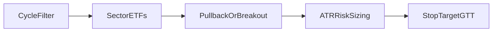

# Comprehensive CNC Swing Strategy Ideation Catalog

Scope locked to **NSE CNC equity/ETF swings (days–weeks) on Groww Cloud**, with your existing **economic-cycle / sector filter** as the macro layer ([`strategies/groww_swing/`](strategies/groww_swing/)). F&O/MIS noted only as future extensions.

## 1. What you already have (baseline stack)

| Layer | Current | File |
|-------|---------|------|
| Macro | Cyclical/defensive, credit, inflation, G/V, breadth, momentum, VIX → phase | [`cycle_filter.py`](strategies/groww_swing/cycle_filter.py) |
| Universe | Sector ETFs | [`universe.py`](strategies/groww_swing/universe.py) |
| Entry | EMA pullback + RSI reclaim; N-day breakout + volume | [`setups.py`](strategies/groww_swing/setups.py) |
| Exit | 2×ATR stop, 2.5R target, max 20d | [`params.json`](strategies/groww_swing/params.json) |
| Size | ~0.75% risk, max 4 trades, 4% heat | [`risk.py`](strategies/groww_swing/risk.py) |

Today’s live scan (**contraction / risk-off / Allowed: none**) is the macro layer correctly vetoing — the catalog below is how to *adapt* instead of only sitting flat.

---

## 2. Strategy anatomy (permutation axes)

Every strategy is a tuple. Exhaustive search = product of axes (thousands of variants); research = score axes, not every combo.

| Axis | Options (CNC-relevant) |
|------|------------------------|
| **A. Horizon** | 3–5d micro-swing · 5–20d classic · 20–60d position-swing |
| **B. Universe** | Sector ETFs · liquid large-caps in favored sectors · RS leaders vs Nifty · dual ETF+stock |
| **C. Macro filter** | Hard veto (current) · Soft (defensives in contraction) · Continuous score→size · Dual ADX trend/range overlay |
| **D. Edge family** | Momentum/trend · Mean-reversion · Breakout/vol-expansion · Relative-strength rotation · Volatility-contraction (NR7/BB squeeze) · Event/earnings (later) |
| **E. Entry trigger** | MA touch · Oscillator reclaim · Donchian/HH break · Pattern (engulfing, pin) · Stat z-score |
| **F. Confirmation** | Volume · Breadth · Sector RS · Candle close beyond level · Multi-TF (daily+60m) |
| **G. Stop** | ATR×k · Structure (swing low) · % · Chandelier · Time-stop |
| **H. Target / manage** | Fixed R · Trail ATR · Scale 50% @1R · MA magnet (MR) · GTT bracket |
| **I. Sizing** | Fixed fractional · Vol-target · Regime-scaled risk · Kelly fraction-cap |
| **J. Portfolio** | Max names · Max sector · Correlation cap · Gross exposure |

**Permutation formula (conceptual):**

\[
\mathcal{S} = A \times B \times C \times D \times E \times F \times G \times H \times I \times J
\]

Practical research: fix A=classic swing, B=sector ETFs, J=current caps; grid **C×D×E×G×H×I** (~200–400 testable variants with walk-forward).

---

## 3. Strategy families (comprehensive list)

### 3.1 Trend / momentum (best in expansion + ADX↑)

1. **EMA pullback continuation** (you have) — long when EMA20>EMA50, price≈EMA20, RSI reclaim  
2. **Dual MA crossover delay** — enter on first pullback after golden cross, not on cross itself  
3. **MACD histogram acceleration** — hist rising from negative while price > EMA50  
4. **Donchian / Turtle breakout** — close > max(high, N), N∈{20,55}  
5. **52-week / 100d high break** — longer swing breakout  
6. **Cross-sectional momentum** — long top-K sector ETFs by 63d return among cycle-allowed  
7. **Time-series momentum** — long if 12–1 month return >0 (Jegadeesh–Titman style, shortened)  
8. **Trend quality filter** — only trade (1–6) if ADX(14)>25 and +DI>-DI  

### 3.2 Mean reversion (best in range / late contraction defensives)

9. **RSI oversold bounce** — RSI<30 then reclaim 30; target EMA20  
10. **Bollinger lower-band fade** — close < BB−2σ then close back inside  
11. **Z-score MR** — \(z=(P-\mu_{20})/\sigma_{20} < -1.5\); exit at z≈0  
12. **Stochastic cross** — %K/%D cross up from <20  
13. **Distance-from-MA revert** — % below EMA50 extreme in defensive sectors only  
14. **Gap fill** — open gap down >1 ATR, fade toward prior close (cash session)  

### 3.3 Volatility / compression → expansion

15. **BB squeeze breakout** — BB width percentile <20 then close outside band  
16. **ATR compression** — ATR(14)/ATR(50) < 0.7 then directional break  
17. **NR7 / Inside bar** — narrowest range in 7 → break prior high/low  
18. **Keltner channel break** — close > KC mid+ATR after squeeze  

### 3.4 Relative strength / rotation (fits your cycle edge)

19. **Sector RS long** — ETF RS vs Nifty 21/63d >0 and rising; among `allowed_sectors`  
20. **Intermarket** — metals/energy when inflation signal rising; IT when DXY/INR supportive (use your unused [`cross_asset.py`](backend/analysis/cross_asset.py) ideas)  
21. **Pairs / spread** — long leader / flat laggard within sector (cash-only: long one, skip short)  
22. **Breadth thrust entry** — new risk only after breadth recovers from <40% to >55%  

### 3.5 Volume / auction

23. **Volume breakout** — price break + vol > 1.5–2× MA  
24. **OBV trend confirm** — OBV making HH with price  
25. **VWAP reclaim** (intraday→swing hold) — daily close back above weekly VWAP  

### 3.6 Structure / price action

26. **Higher-low trend** — HL + break of minor swing high  
27. **Support bounce** — prior swing low / weekly pivot hold  
28. **Failed breakout fade** — false HH then close back in range (MR cousin)  

### 3.7 Calendar / seasonality (secondary)

29. **Month-end / expiry week** effects on Bank/Nifty ETFs (test, don’t assume)  
30. **Post-RBI / budget** playbooks as *override filters*, not core edge  

### 3.8 Meta / adaptive (highest leverage for you)

31. **Regime router** — if expansion+ADX high → MOM family; if contraction/range → MR defensives; if VIX fear → flat or tiny size  
32. **Score-scaled risk** — risk_pct × f(cycle_score, setup_quality)  
33. **Ensemble vote** — require ≥2 of {pullback, RS, volume}  

---

## 4. Indicator & formula library

### Trend
- \(\mathrm{EMA}_n = \mathrm{EWMA}(P,\alpha=2/(n+1))\)
- \(\mathrm{SMA}_n\), Hull MA (optional)
- MACD: \(12/26/9\) EMA diff + signal + hist
- ADX / +DI / −DI (Wilder) — **regime discriminator**
- Supertrend: \( \mathrm{HL2} \pm m\cdot\mathrm{ATR} \)

### Momentum / oscillators
- RSI Wilder; Stochastic; CCI; Williams %R
- Rate of change: \(\mathrm{ROC}_n = P_t/P_{t-n}-1\)
- Connors RSI (optional short-horizon)

### Volatility
- ATR (Wilder); True Range
- Parkinson / Garman–Klass estimators (from OHLC)
- Bollinger: \(\mu \pm k\sigma\); %B; bandwidth
- Historical vol: \(\sigma\sqrt{252}\) of log returns
- India VIX level & z vs 60d mean (you have thresholds)

### Breadth / market (you partially have)
- % sectors > MA50 / MA200
- Advance–decline proxy from sector closes
- Cyclical/defensive ratio (core Pulse signal)

### Relative strength
- \(\mathrm{RS} = R_{\mathrm{asset}}-R_{\mathrm{bench}}\) over \(n\in\{21,63,126\}\)
- Rank percentile cross-section of ETFs

### Volume
- Vol SMA; RVOL = vol / SMA
- OBV; Chaikin Money Flow; VWAP

### Stats for signals
- Z-score, rolling skew/kurtosis
- Autocorrelation lag-1 of returns (trend persistence)
- Hurst exponent (rough: trend vs MR regime)
- Correlation matrix of open positions (portfolio heat)

---

## 5. Signal formulas (concrete, implementable)

**Pullback (current):**  
`EMA20>EMA50 ∧ |P−EMA20|/P ≤ 1.5% ∧ RSI ∈ [40,55] (or reclaim from <40)`

**Breakout (current):**  
`P > max(high)_{1..N} ∧ EMA20>EMA50 ∧ vol ≥ 1.1·volMA`

**Z-MR:**  
`z20 < −1.5 ∧ sector ∈ defensives ∧ ADX < 20` → target `μ20`, stop `entry − 1.5·ATR`

**Squeeze break:**  
`BBwidth_pctile_120 < 20 ∧ close > BB_upper ∧ cycle not risk_off_hard`

**RS rotation:**  
`sector ∈ allowed ∧ RS63 > 0 ∧ RS63 > RS21` (accelerating) ∧ setup ∈ {pullback, breakout}

**Stop / target:**  
\( S = P - k\cdot\mathrm{ATR}_{14},\quad T = P + R\cdot(P-S) \) with \(k\in[1.5,2.5], R\in[1.5,3]\)

**Size:**  
\( q = \lfloor (C\cdot r) / (P-S) \rfloor \), \(r\in[0.005,0.015]\), heat \(\sum q_i(P_i-S_i)/C \le H\)

**Regime-scaled risk:**  
\( r' = r \cdot m(\mathrm{phase},\mathrm{ADX},\mathrm{VIX}) \) e.g. early_exp×1.0, late×0.75, contraction_MR×0.5, fear×0

---

## 6. Research & statistics to score each permutation

| Metric | Why |
|--------|-----|
| Expectancy \(E[R]\) in R-multiples | Primary edge |
| Profit factor, win rate, payoff ratio | Shape of edge |
| Sharpe / Sortino / Calmar | Risk-adjusted |
| Max DD, Ulcer, time-underwater | Psychological & capital |
| Trade count, avg hold days | Sample adequacy (need ≫11) |
| Edge vs costs (bps) | Groww reality |
| Walk-forward / purged CV | Avoid overfit |
| Regime-conditional expectancy | Does MOM die in contraction? |
| Bootstrap CI on \(E[R]\) | Is edge noise? |
| Capacity / liquidity | ETF ADV vs size |

**Research protocol (fixed):**
1. Groww daily candles 2020→now (chunked API) for sector ETFs  
2. In-sample 2020–2023 tune; OOS 2024–2026  
3. Always report **with vs without** cycle filter  
4. Min 80–100 trades for promotion; else paper only  

---

## 7. High-value permutation matrix (what to actually grid)

Fix: universe = sector ETFs, costs = 10 bps, max hold = 20d.

| ID | Macro C | Family D | Entry E | Stop k | Target R | Risk r | Hypothesis |
|----|---------|----------|---------|--------|----------|--------|------------|
| S0 | hard veto | MOM | pullback+breakout | 2.0 | 2.5 | 0.75% | **Current baseline** |
| S1 | soft defensives | MOM | same | 2.0 | 2.5 | 0.75% | Fewer flat days |
| S2 | hard | MOM | + ADX>25 | 2.0 | 2.5 | 0.75% | Fewer chop trades |
| S3 | router | MOM\|MR | pullback \| z-MR | 2.0 / 1.5 | 2.5 / MA | 0.75%/0.5% | **Adaptive core** |
| S4 | soft | RS rot | top-2 RS + pullback | 2.0 | 2.5 | 1.0% | Cycle×momentum |
| S5 | hard | squeeze | BB squeeze BO | 1.5 | 3.0 | 0.5% | Vol expansion |
| S6 | score→size | MOM | current | 2.0 | trail 3ATR | scale 0.5–1.0% | Better tails |
| S7 | hard | Turtle | Donchian 20/55 | 2N | 10N trail | 0.5% | Classic trend |

Promote only if OOS \(E[R]>0\) and beats S0 on Calmar after costs.

---

## 8. Mapping to Pulse / Groww Cloud implementation

| Catalog piece | Where it lands |
|---------------|----------------|
| Indicator library | `strategies/groww_swing/indicators.py` (ADX, BB, MACD, z, squeeze) |
| Setup plugins | `setups.py` → registry `SETUPS = {pullback, breakout, z_mr, squeeze, donchian}` |
| Regime router | `cycle_filter.py` + new `regime_router.py` (cycle phase × ADX × VIX → mode) |
| Grid backtest | extend [`backtest.py`](strategies/groww_swing/backtest.py) with strategy_id + param grid |
| UI | Swing page: strategy picker + OOS metrics table |
| Live Cloud | `main.py` reads `params.json.strategy_id` |

**Chosen next implementation (default):** **S3 regime router** — keep hard risk-off on VIX fear; in contraction+low ADX allow defensive **z-MR / RSI bounce**; in expansion keep current pullback/breakout. This directly addresses today’s “Allowed: none” without abandoning the cycle edge.

---

## 9. Explicit non-goals (for this catalog phase)

- Full F&O / options Greeks strategies  
- HFT / tick scalping  
- Blind ML on 11-trade samples  
- Live order flipping before OOS promotion of S3  

---

## 10. Implementation status

| Piece | Location |
|-------|----------|
| This catalog | `docs/swing-strategy-catalog.md` |
| Indicators | `strategies/groww_swing/indicators.py` |
| Setup registry | `strategies/groww_swing/catalog.py`, `setups.py` |
| Regime router S3 | `strategies/groww_swing/regime_router.py` |
| A/B backtest | `strategies/groww_swing/backtest.py` (`compare_strategies`) |
| UI | `/swing` strategy picker + S0 vs S3 metrics |  
